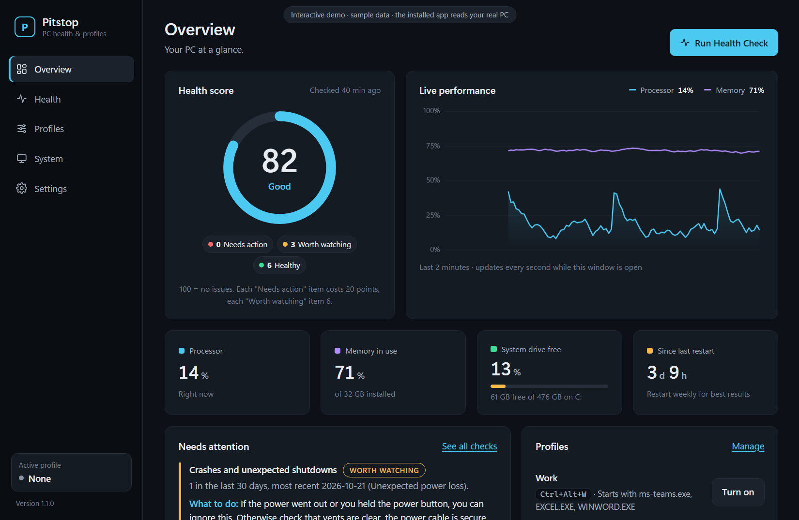
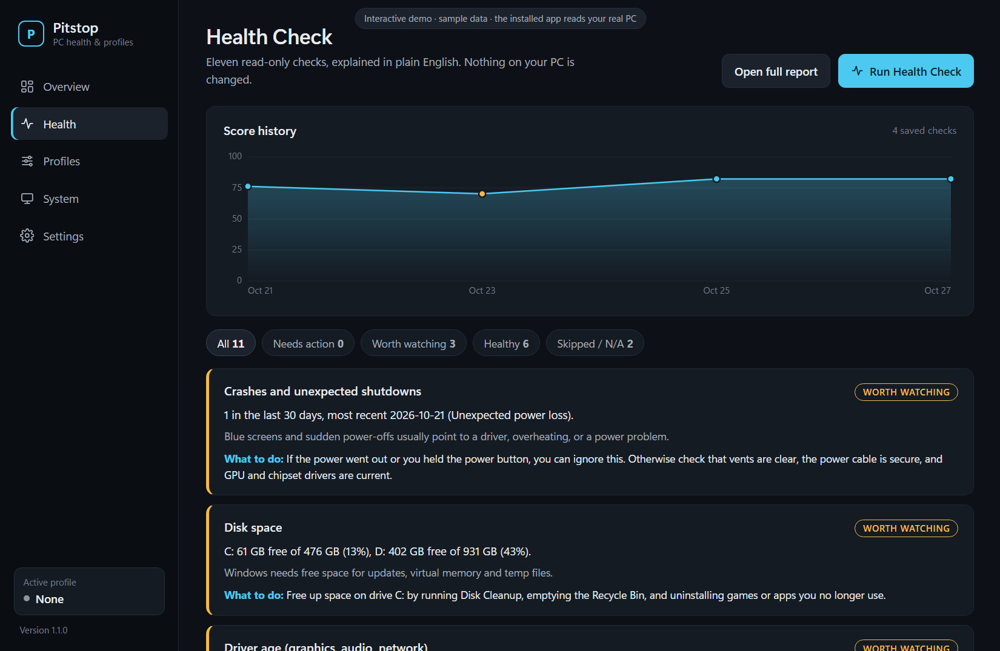
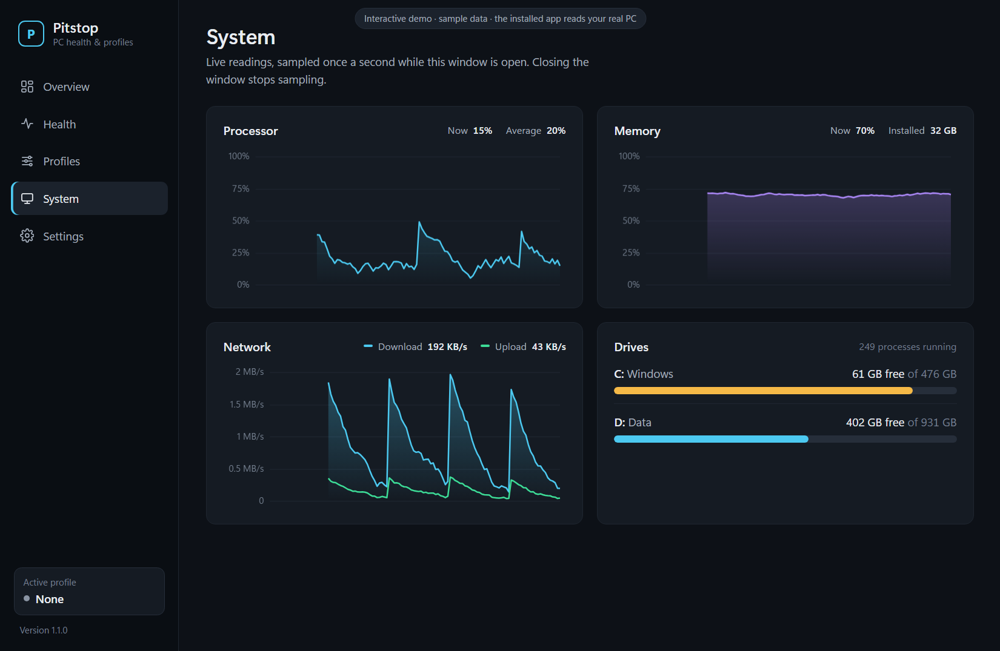
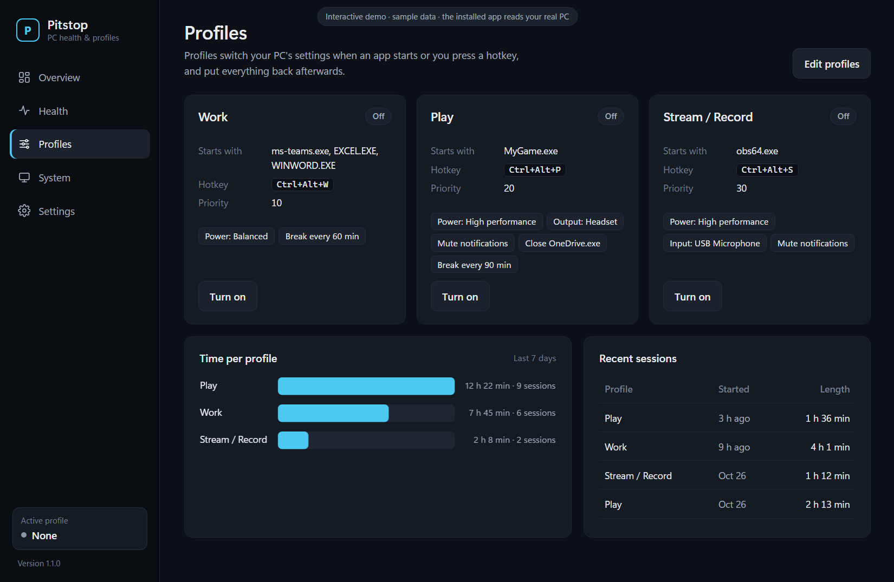
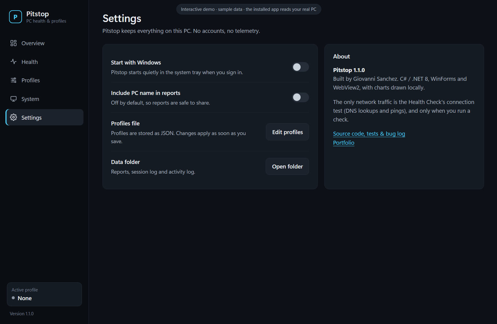
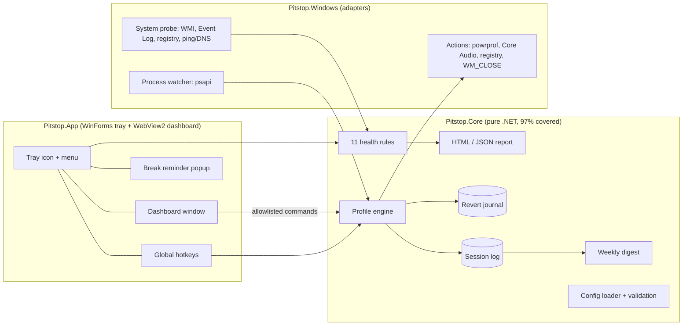

# Pitstop

[](https://github.com/doctorg1998/pitstop/actions/workflows/ci.yml)


**A lightweight Windows 11 tray app that does two jobs:**

1. **Health Check**: a one-click, read-only PC checkup, like a technician's bench test. It writes a plain-English report you can share.
2. **Profiles**: automatic modes that switch your PC's settings when an app starts, then put everything back when it closes.

It runs in the background at **about 0.1% CPU and 14–21 MB of private memory**, needs **no admin rights**, and **sends no data anywhere**.



## Dashboard (v1.1)
Open Pitstop from the Start menu, or double-click its tray icon:

| Page | What's on it |
|---|---|
| **Overview** | A 0–100 health score, live CPU and memory graph, quick stats, what needs attention, one-click profile switches |
| **Health** | Every check with severity filters and plain-English fixes, plus a score-history chart across saved checks |
| **Profiles** | Profile cards with on/off buttons, time-per-profile chart for the week, recent sessions |
| **System** | Live processor, memory and network graphs, plus per-drive usage |
| **Settings** | Start with Windows, report privacy, profile file, data folder |

**Design goals:** readable first (large type, high contrast, plain-English labels), then sophisticated (Windows 11's own Segoe UI Variable, a restrained dark palette, one accent color).

**How it's built:**
- Charts are drawn on canvas with no chart library, and nothing loads from the internet.
- The window and its WebView2 processes exist only while it's open. Closing it frees about 300 MB and stops the sampling.

| Health | System |
|---|---|
|  |  |
| **Profiles** | **Settings** |
|  |  |

*Screenshots use the dashboard's built-in sample data, so no real PC's devices or apps are shown. The installed app shows your own live readings.*

---

## Health Check
Eleven checks run in parallel in about 5 seconds. Each result is rated **OK / Watch / Action / Skipped / N/A** and comes with *what it means* and *what to do*.

| Check | What it looks at |
|---|---|
| Windows updates | Build number and date of the last installed update |
| Time since restart | Uptime (Fast Startup shutdowns don't count as restarts) |
| Crashes | Blue screens and unexpected shutdowns in the last 30 days; the multiple events one crash logs count as a single incident |
| Disk space | Free space per drive, with percentages |
| Drive health | Windows' own healthy / warning / unhealthy verdict per drive |
| Memory and CPU | Load over a 3-second sample |
| Startup apps | Enabled startup entries (respects Task Manager's "disabled") |
| Driver age | Graphics, audio and network drivers from hardware vendors; virtual devices are ignored |
| Network | Router and internet latency and packet loss, plus DNS lookup time |
| Battery wear | Remaining capacity versus design capacity (laptops) |
| Temperature | Thermal zone reading (needs Run as administrator; otherwise skipped with that explanation) |

Reports are self-contained HTML (dark theme, light theme when printed) plus JSON. They're **redacted by default**: no PC name or username.
See a sample from a real run, with device and app names anonymized: [`docs/sample-health-report.html`](docs/sample-health-report.html).

## Profiles
Edit `%LOCALAPPDATA%\Pitstop\config.json` (tray → Profiles → Edit profiles…). Changes apply live, and an invalid edit is rejected while your working profiles stay active.

```json
{
  "id": "stream", "name": "Stream / Record", "priority": 30,
  "triggers": { "processes": ["obs64.exe"], "hotkey": "Ctrl+Alt+S" },
  "actions": {
    "powerPlan": "High performance",
    "audioInput": "USB Microphone",
    "muteNotifications": true,
    "closeApps": ["OneDrive.exe"],
    "breakReminderMinutes": 90
  }
}
```

| Action | Notes |
|---|---|
| Power plan | Switched with the native power API; the previous plan is restored |
| Default audio output / input | Matches by part of the device name; switches all three Windows audio roles and restores them |
| Mute notifications | Per-user Windows setting; restored afterwards |
| Close apps | Polite close request only (never force-killed); core Windows processes are always protected; relaunched on revert |
| Launch apps | Any program path |
| Break reminders | A corner popup that never steals focus, because a Windows notification would be muted by the profile itself |

**Rules:**
- A hotkey or menu choice overrides automatic triggers until you toggle it off.
- Otherwise the highest-priority running trigger wins, and ties go to the most recently started app.
- When the app closes, Pitstop falls back to the next match or to no profile.

**Crash-safe:** every change a profile makes is written to a revert journal first. If Pitstop crashes or the PC loses power mid-profile, the next start restores your settings.

**Weekly digest:** time spent per profile, your last 4 Health Checks, and anything that still needs attention.

## Install
Download from the [latest release](https://github.com/doctorg1998/pitstop/releases/latest):
- **Installer:** `Pitstop-Setup-1.1.0.exe`. Per-user, no admin prompt. Optionally starts with Windows.
- **Portable:** unzip `Pitstop-portable-win-x64.zip` and run `Pitstop.exe`.

Both are self-contained, so .NET doesn't need to be installed. Checksums are in `SHA256SUMS.txt`.

The installer isn't code-signed yet, so Windows SmartScreen may warn on first run. Choose **More info**, then **Run anyway**. Every release is built and tested by CI from its tag.

**Command line**
```text
Pitstop.exe                 run in the tray
Pitstop.exe --check [dir]   run a Health Check, write the report, exit (code 0 OK, 1 Watch, 2 Action, 3 error)
Pitstop.exe --diag  [file]  write a support snapshot of power plans, audio devices and watcher timing (changes nothing)
```

## How it's tested
QA is a first-class feature of this project, not an afterthought.

- **177 automated tests** (xUnit), with **97.0% line and 87.7% branch coverage** of `Pitstop.Core`. That includes negative security tests for every kind of malformed or forged dashboard message.
  - All logic runs against fakes (`FakeSystem`, `FakeClock`, `FakeFileStore`), so the tests run on any machine and in CI.
  - Parsers are tested against device IDs and names recorded from a real PC.
- **Live integration runs** on real hardware. Each scripted step checks the real system state before and after (power plan, default audio device, running apps, the journal). The runs cover:
  - switching and reverting
  - force-killing the app mid-profile, then recovering
  - live config reload
  - a simulated global hotkey
  - install and uninstall
  - idle cost
- **The dashboard was tested in the real app window**, driven through WebView2's local debugging protocol. The tests ran a Health Check, toggled a profile (checking the real power plan), sent forged messages, and confirmed that closing the window frees the browser processes.
- **[Test plan](docs/TEST-PLAN.md)** with entry and exit criteria, live results (L1–L22) and a manual QA checklist.
- **[Bug log](docs/BUGS.md)**: 15 real bugs found during development, written up as support tickets with repro steps, root cause, fix and regression test. Highlights:
  - **BUG-004:** Pinging too fast made public DNS servers throttle the test, faking 20–25% packet loss. Isolated by measuring loss at four different ping intervals.
  - **BUG-008:** Measured 72 MB of private memory, traced it to a second UI framework, and cut it to 14 MB (−80%).
  - **BUG-010:** Cut the installer 33% by removing that framework from the package.
- **CI** (GitHub Actions, Windows runner): build, test, coverage summary, self-contained publish, portable zip and installer on every push.

## Architecture

Core has no Windows dependencies. Everything platform-specific sits behind interfaces (`ISystemProbe`, `IPowerPlans`, `IAudioDevices`, `IProcessWatcher`…), which is what makes it testable.

## Performance (Release build, real PC)
| Metric | Target | Measured |
|---|---|---|
| Idle CPU (window closed) | under 1% | 0.03–0.10% of one core |
| Private memory (window closed) | under 80 MB | 14–21 MB |
| Dashboard open | — | About 300 MB across the WebView2 processes; all released on close |
| Health Check | — | 5.1 s for 11 checks |
| Profile switch | — | about 2 s after the app starts or exits |
| Installer size | — | 33 MB (self-contained) |

## Privacy
- **No telemetry, no accounts, no cloud.** Everything is stored in `%LOCALAPPDATA%\Pitstop`.
- **The only network traffic** is the Health Check's connection test (DNS lookups and pings), and only when you run a check.
- **Health Check is read-only.** Profiles only change the settings you configure, and every change is undone afterwards.

## Known limitations
See [DESIGN.md § Known limitations](docs/DESIGN.md#9-known-limitations), including the undocumented `IPolicyConfig` audio interface and polling-based process detection (no admin rights needed).

## Built with
- **Code:** C# / .NET 8, WinForms and Win32 interop, WebView2 with HTML/CSS/canvas for the dashboard, xUnit, Inno Setup and GitHub Actions.
- **AI coding agent:** I designed, directed, tested and verified Pitstop, using Claude as the coding agent under a written design ([DESIGN.md](docs/DESIGN.md)). Every number in this README was measured, not estimated.

**Author:** Giovanni Sanchez · [Portfolio](https://doctorg1998.github.io) · [LinkedIn](https://www.linkedin.com/in/giovanni-sanchez-056b73315)

[MIT License](LICENSE)
